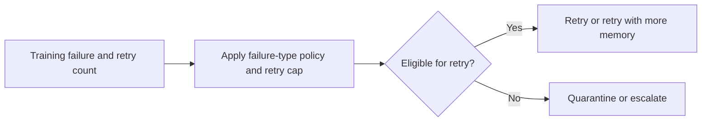

# ML Training Retry Orchestrator

Unconditional retries can waste training capacity and repeat permanent failures. Operators need a bounded policy for retry, quarantine, or escalation.

## What I built

I built a training recovery policy that retries transient failures below a cap, allows a bounded retry with more memory for OOM, and quarantines schema or data-contract failures. Other cases go to escalation.

## How it works



[Architecture](docs/ARCHITECTURE.md) · [Decision rules and source](docs/RULES.md)

## Tools used

| Tool | Role in this repository |
| --- | --- |
| Python | [retry_orchestrator.py](retry_orchestrator.py) implements the CLI and decision rules. Uses `csv` to read tabular exports. |
| Make | Runs the documented example and the local `unittest` suite. |
| Python replay runner | Compares actual stdout with the checked-in baseline fixtures. |
| Ruff and Bandit | Developer lint and static security checks through `make check`. |

## Run the project

Use Python 3.10+ and Make. From the repository root:

```sh
python3 retry_orchestrator.py sample_failures.csv
```

The sample retries tr-101, quarantines tr-102, and escalates tr-103. [Full expected output](examples/Demo%201.stdout.txt)

### Additional replay cases

- **Last sample record in isolation** · `python3 retry_orchestrator.py examples/last-record.csv` · [Expected output](examples/Last%20sample%20record%20in%20isolation.stdout.txt)

## Verify the project

```sh
make verify
make replay
```

`make replay` checks the recorded cases and exits nonzero if the output changes.
See the [developer guide](docs/DEVELOPMENT.md) for the pinned lint and security tools.

## Operating limits

The tool emits recommendations. Execution, resource allocation, and quarantine enforcement belong to the training platform.

[Case study](docs/CASE_STUDY.md) · [Operator runbook](docs/RUNBOOK.md) · [Verification report](reports/verification.md)
