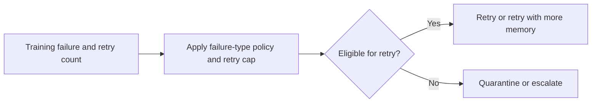

# ML Training Retry Orchestrator

Classifies failed ML training jobs into retry, quarantine, or escalate actions based on failure mode and recent retry history.

Focus: MLOps, training orchestration, SRE incident reduction.

Portfolio framing: Apple-scale client-style AI platform project using synthetic data only.

## Run

```bash
python3 retry_orchestrator.py sample_failures.csv
```

## Verify

```bash
python3 -m unittest discover . -v
```

## Local verification

Run `make verify` with Make and Python 3 installed. The target runs the documented sample through the project CLI. It also runs the existing Python unit tests.

## Business problem

Unconditional retries can waste training capacity and repeat permanent failures. Operators need a bounded policy for retry, quarantine, or escalation.

## Project walkthrough



[Architecture and data flow](docs/ARCHITECTURE.md) · [Business problem, demo, and verification](docs/CASE_STUDY.md)
