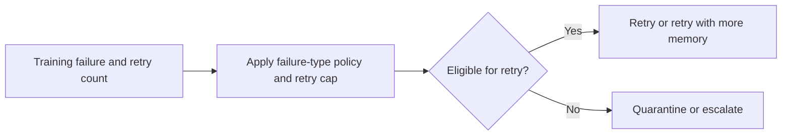

# Ml Training Retry Orchestrator architecture

Classifies failed ML training jobs into retry, quarantine, or escalate actions based on failure mode and recent retry history.

## Operational boundaries

The documented run evaluates the bundled sample locally. Results depend on the quality and scope of the input. The demo makes no live infrastructure changes.
